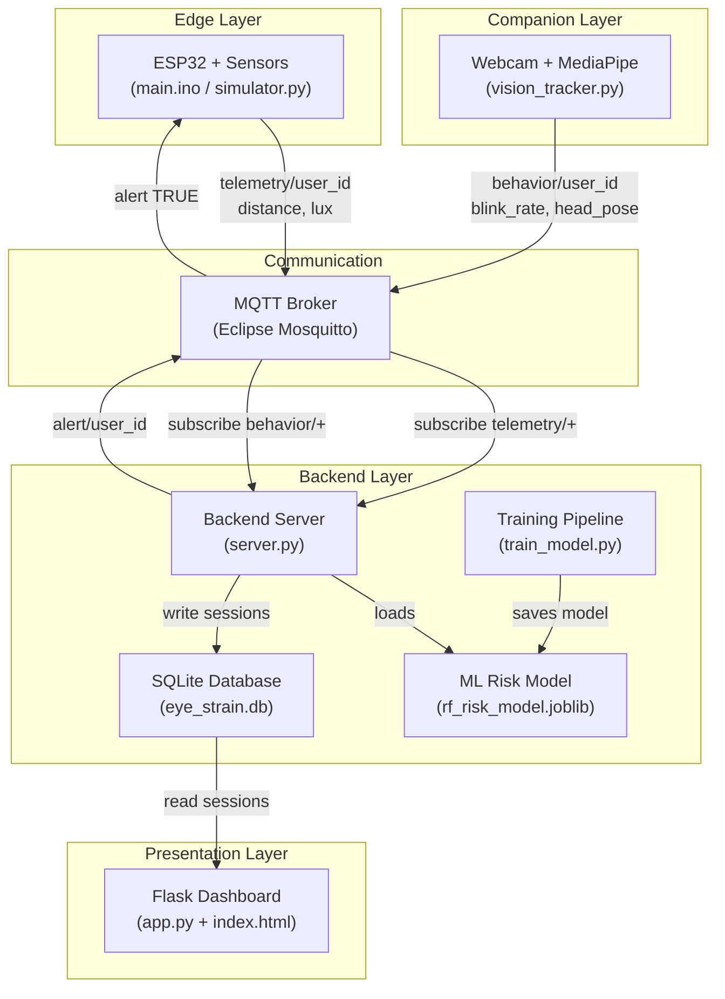
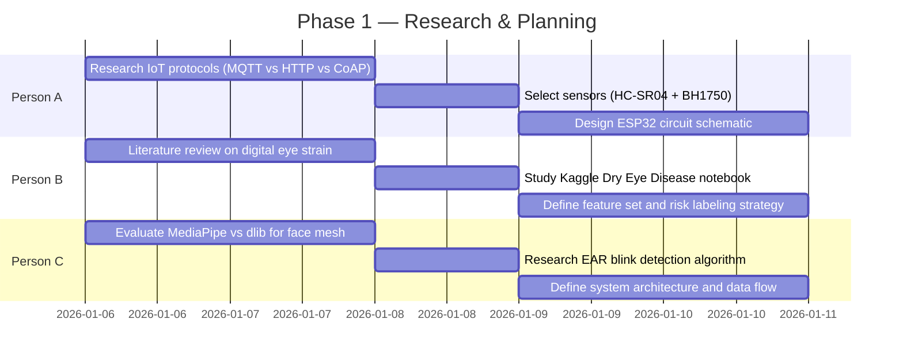
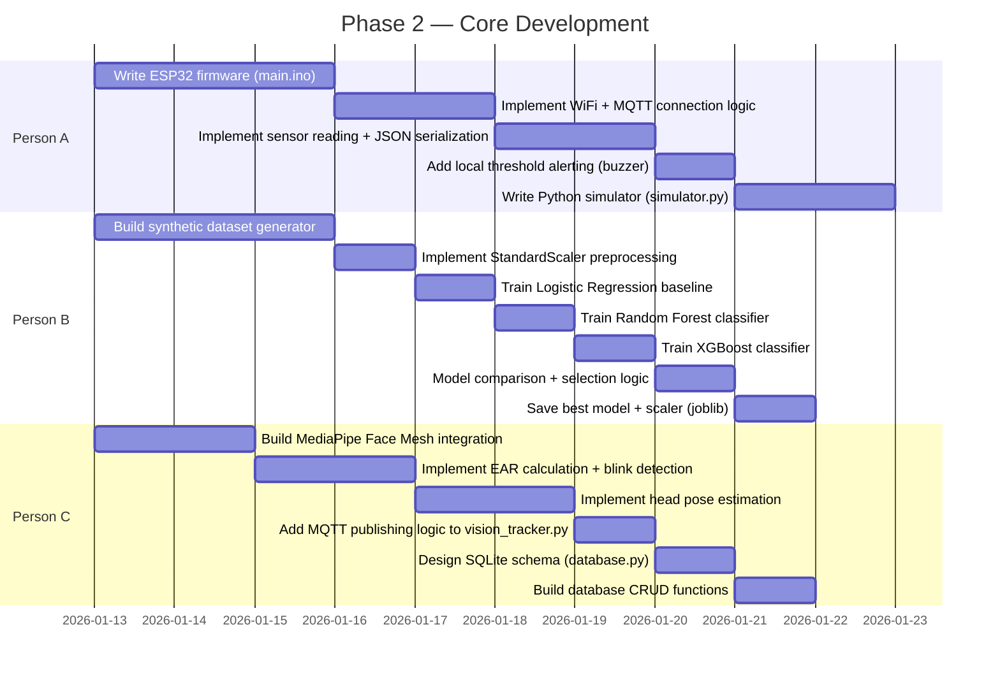
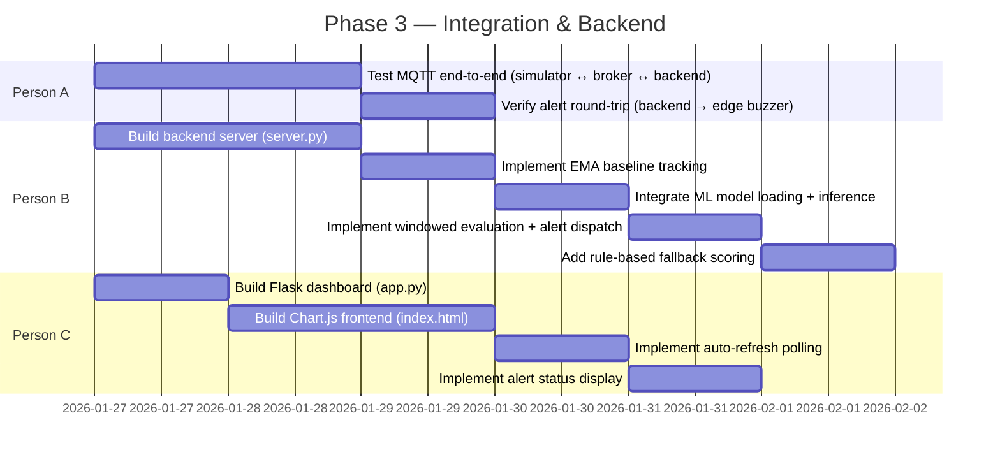
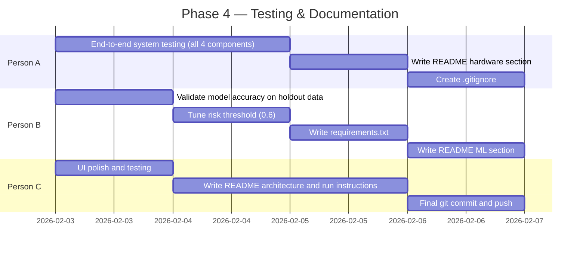

# Digital Eye Strain Monitoring System — Full Documentation

## 1. Project Overview

The **Digital Eye Strain Monitoring System** is an IoT + Machine Learning application that monitors a user's screen-viewing habits in real-time and alerts them when their risk of digital eye strain becomes high. It combines hardware sensor data (screen distance, ambient light) with computer-vision-derived behavioral data (blink rate, head pose) to compute a personalized risk score using a trained ML model.

---

## 2. Architecture Diagram




---

## 3. Data Flow (Step-by-Step)

```
┌──────────────┐   MQTT: telemetry/user1    ┌─────────────────┐
│ Edge Device  │ ──────────────────────────► │                 │
│ (Distance,   │                             │  Backend Server │
│  Ambient Lux)│                             │  (server.py)    │
└──────────────┘                             │                 │
                                             │  1. Buffers data│
┌──────────────┐   MQTT: behavior/user1      │  2. Averages    │
│ Companion App│ ──────────────────────────► │  3. Computes    │
│ (Blink Rate, │                             │     deviation   │
│  Head Pose)  │                             │  4. ML scoring  │
└──────────────┘                             │  5. Alerts      │
                                             │  6. Logs to DB  │
                     MQTT: alert/user1       │                 │
               ◄──────────────────────────── │                 │
                                             └────────┬────────┘
                                                      │ SQLite
                                             ┌────────▼────────┐
                                             │  Dashboard      │
                                             │  (Flask + Chart)│
                                             │  Polls DB every │
                                             │  5 seconds      │
                                             └─────────────────┘
```

1. **Edge Device** publishes `distance` (cm) and `lux` (ambient light) to `telemetry/user1` every **5 seconds**.
2. **Companion App** publishes `blink_rate`, `incomplete_blink_ratio`, `gaze_dev`, `head_pose`, and `cam_conf` to `behavior/user1` every **5 seconds**.
3. **Backend Server** subscribes to both topics, buffers incoming readings, and triggers a **window evaluation** every **3 behavior readings** (~15 seconds).
4. During evaluation, it computes **averages** over the buffer, calculates **deviations** from the user's EMA baseline, and runs the **ML model** to get a risk probability.
5. If risk > **0.6**, it publishes `"TRUE"` on `alert/user1` — the edge device sounds a **buzzer**.
6. Every evaluation is **logged to SQLite** (`sessions` table).
7. The **Dashboard** polls the SQLite database every **5 seconds** and renders a Chart.js line graph.

---

## 4. File-by-File Code Walkthrough

---

### 4.1 Edge Device — [main.ino](file:///c:/Users/rishi/Downloads/eye_strain_monitor/edge_device/main.ino)

**Purpose**: ESP32 Arduino firmware — the physical hardware component.

**Minimal Hardware Configuration (No Battery, No Vibration Motor)**:
The edge hardware operates with zero batteries and zero electro-mechanical vibration motors. It is powered continuously via a standard 5V USB connection (PC USB port or USB power bank), and utilizes an active piezo buzzer directly driven from GPIO 23 for all alert cues.

| Component | Library / Interface | Pin(s) / Connections | Purpose |
|---|---|---|---|
| **ESP32 DevKit V1** | `WiFi.h` | Micro-USB / Type-C (5V) | Main edge controller, Wi-Fi telemetry & MQTT client. Powered via USB (no 9V battery). |
| **HC-SR04 Ultrasonic** | Direct `pulseIn()` (Native) | VCC -> 5V (VIN), GND -> GND, Trig -> GPIO 5, Echo -> GPIO 18 (via 1k/2k divider) | Measures screen-to-face viewing distance (cm). |
| **1kΩ / 2kΩ Voltage Divider** | Passive Resistors | Echo (5V) -> 1kΩ -> GPIO 18 -> 2kΩ -> GND | Drops 5V Echo output down to safe 3.3V logic for the ESP32. |
| **BH1750 Ambient Light** | `BH1750.h` / `Wire.h` (I2C) | VCC -> 3.3V, GND -> GND, SDA -> GPIO 21, SCL -> GPIO 22 | Calibrated ambient illuminance measurement (lux). |
| **Active Buzzer** | Direct GPIO Drive | Buzzer (+) -> GPIO 23, Buzzer (-) -> GND | Acoustic alert actuation (250ms local burst, 800ms backend alert). Configurable active-high/low via `BUZZER_ACTIVE_HIGH`. |

**How it works**:
1. **Power-On & Setup (`setup()`)**:
   - ESP32 powers on directly from the USB 5V rail (stepping down to 3.3V internally via its AMS1117 regulator).
   - Initializes Serial (115200 baud), I2C bus (`Wire.begin(21, 22)`), and Wi-Fi station mode.
   - Connects to the local MQTT broker (`1883`) and subscribes to `alert/user1`.
   - **Self-Test**: Executes a 100 ms confirmation chirp on the active buzzer to verify buzzer polarity and functionality at boot.
2. **Continuous Sensing & Filtering (`loop()`)**:
   - **1-Second Polling**: Reads distance using a 3-ping median filter + exponential smoothing ($\alpha = 0.70$) via `pulseIn()`, and samples illuminance from BH1750 over I2C.
   - **Local Safety Threshold**: If distance drops below 25 cm or ambient light drops below 30 lux, the ESP32 immediately sounds a 250 ms non-blocking local warning pulse on the buzzer without waiting for backend ML evaluation.
   - **5-Second Batched Telemetry**: Formats `device_id`, `distance`, `lux`, and uptime `timestamp` into JSON using lightweight `snprintf` (zero external JSON library overhead) and publishes to `telemetry/user1`.
3. **Remote ML Alert Handling (`mqttCallback()`)**:
   - Listens on `alert/user1`. When the backend machine learning model detects high strain risk and publishes `"TRUE"`, the ESP32 executes an 800 ms non-blocking acoustic alert on the active buzzer.
   - Filters strictly for `"TRUE"` or `"true"` strings, avoiding false triggers on numeric scores or negative status payloads.

> [!IMPORTANT]
> The firmware has **two alert mechanisms**: a **local threshold** (immediate, rule-based) and a **backend alert** (ML-driven, delayed but smarter). This dual-layer approach ensures the user gets fast warnings for extreme cases while the ML model handles nuanced risk assessment.

---

### 4.2 Edge Device Simulator — [simulator.py](file:///c:/Users/rishi/Downloads/eye_strain_monitor/edge_device/simulator.py)

**Purpose**: Python stand-in for the ESP32 hardware — generates random telemetry for testing without physical sensors.

**Key Logic**:
- Generates random `distance` (15–60 cm) and `lux` (20–200) values
- Applies the same local threshold logic (`distance < 25` or `lux < 30`)
- Publishes to MQTT every 5 seconds, listens for alert commands
- Prints `"BUZZER SOUNDING!"` when alert received (simulates physical buzzer)

---

### 4.3 Companion App — [vision_tracker.py](file:///c:/Users/rishi/Downloads/eye_strain_monitor/companion_app/vision_tracker.py)

**Purpose**: Uses the webcam + Google MediaPipe Face Mesh to extract eye/face behavioral metrics in real-time.

**Key Components**:

#### Eye Aspect Ratio (EAR) — Blink Detection
```
EAR = (|P2 - P6| + |P3 - P5|) / (2 × |P1 - P4|)
```
- Uses 6 landmark points per eye (from MediaPipe's 468-point face mesh)
- **Left eye indices**: `[33, 160, 158, 133, 153, 144]`
- **Right eye indices**: `[362, 385, 387, 263, 373, 380]`
- EAR drops when eyes close → crossing `EAR_THRESH = 0.2` signals a blink
- `EAR_INCOMPLETE_THRESH = 0.25` detects partial/incomplete blinks (clinically significant for dry eye)

#### Head Pose Estimation
- Uses nose tip (landmark #1) relative to face edges (landmarks #234, #454)
- Computes asymmetry as a rough proxy for head tilt/rotation
- `gaze_dev = |nose_to_left - right_to_nose| × 100`

#### Publishing Cycle (every 5 seconds):
```json
{
  "user_id": "user1",
  "blink_rate": 14.5,              // blinks per minute (extrapolated)
  "incomplete_blink_ratio": 0.15,  // fraction of incomplete blinks
  "gaze_dev": 3.2,                 // head pose deviation metric
  "head_pose": 3.2,                // same as gaze_dev in this version
  "cam_conf": 1.0,                 // 1.0 = face detected, 0.0 = not
  "timestamp": 1695382800000       // epoch milliseconds
}
```

> [!NOTE]
> **Medical Basis**: Normal spontaneous blink rate is 15–20/min. During concentrated screen use, it drops to ~3–4/min (Tsubota & Nakamori, 1993). Reduced and incomplete blinks are leading causes of digital eye strain and dry eye.

---

### 4.4 Backend Database — [database.py](file:///c:/Users/rishi/Downloads/eye_strain_monitor/backend/database.py)

**Purpose**: SQLite persistence layer with 3 tables.

| Table | Columns | Purpose |
|---|---|---|
| `telemetry` | `id`, `user_id`, `distance`, `lux`, `timestamp` | Raw edge device readings |
| `behavior` | `id`, `user_id`, `blink_rate`, `incomplete_blink_ratio`, `gaze_dev`, `head_pose`, `cam_conf`, `timestamp` | Raw vision tracker readings |
| `sessions` | `id`, `user_id`, `risk_score`, `alert_dispatched`, `timestamp` | Aggregated risk evaluation results |

**Functions**: `init_db()`, `insert_telemetry()`, `insert_behavior()`, `insert_session()`, `get_recent_sessions(limit=50)`.

---

### 4.5 Backend Server — [server.py](file:///c:/Users/rishi/Downloads/eye_strain_monitor/backend/server.py)

**Purpose**: The central brain — subscribes to MQTT, aggregates sensor data, runs ML inference, dispatches alerts.

#### Key Mechanisms:

**1. Exponential Moving Average (EMA) Baseline**
```python
baseline[key] = α × new_value + (1 − α) × old_baseline    # α = 0.1
```
- Tracks the user's "normal" over time — each user drifts differently
- Deviations from baseline feed into the ML model as features (`d_dev`, `l_dev`, `br_dev`)
- Low α (0.1) means the baseline adapts slowly → captures long-term habits, not noise

**2. Windowed Evaluation (`check_window()`)**
- Triggered every **3 behavior readings** (~15 seconds of data)
- Computes average distance, lux, and blink rate across the buffer
- Computes deviation = current average − EMA baseline
- Calls `compute_risk_score()` with both raw features and deviations

**3. ML Risk Scoring (`compute_risk_score()`)**
- Loads the pre-trained RandomForest model + StandardScaler from `.joblib` files
- Constructs a feature DataFrame: `[d_avg, l_avg, blink_rate, d_dev, l_dev, br_dev]`
- Applies `scaler.transform()` to normalize (matching the training pipeline)
- Returns `predict_proba()[0][1]` — probability of **high risk** class
- **Fallback**: If model fails to load, uses a simple rule-based heuristic

**4. Alert Dispatch**
- If `risk_score > 0.6` → publishes `"TRUE"` to `alert/user1`
- Logs every session to SQLite regardless of alert status

---

### 4.6 ML Training Pipeline — [train_model.py](file:///c:/Users/rishi/Downloads/eye_strain_monitor/backend/train_model.py)

**Purpose**: Trains and compares multiple ML models, saves the best one for production use.

#### Pipeline Steps:

**Step 1 — Synthetic Dataset Generation** (`generate_realistic_dataset()`):
- 50 users × 40 sessions = **2,000 samples**
- Each user has a personal baseline (random normal ranges for distance, light, blink rate)
- 5 session types with medically-grounded parameters:

| Session Type | Distance | Lux | Blink Rate | Risk Probability |
|---|---|---|---|---|
| Comfortable (35%) | ~60 cm | ~400 lux | ~17 blinks/min | 0% |
| Dim Room (15%) | ~55 cm | ~50 lux | ~14 blinks/min | 60% |
| Too Close (15%) | ~25 cm | ~350 lux | ~13 blinks/min | 65% |
| Prolonged Fatigue (20%) | ~50 cm | ~320 lux | ~5 blinks/min | 85% |
| Combined Strain (15%) | ~20 cm | ~30 lux | ~4 blinks/min | 92% |

- 6 features: `d_avg`, `l_avg`, `blink_rate`, `d_dev`, `l_dev`, `br_dev`
- Binary target: `risk_label` (0 = low risk, 1 = high risk)

**Step 2 — Preprocessing**:
- 80/20 stratified train/test split
- StandardScaler normalization (saved as `scaler.joblib`)

**Step 3 — Model Training & Comparison**:

| Model | Configuration | Purpose |
|---|---|---|
| Logistic Regression | `C=1.0`, `class_weight='balanced'` | Linear baseline |
| Random Forest | `n_estimators=100`, `max_depth=8`, `class_weight='balanced'` | Non-linear ensemble |
| XGBoost | `n_estimators=150`, `max_depth=6`, `scale_pos_weight=auto` | Gradient boosting (optional) |

**Step 4 — Model Selection**: Best model by **ROC-AUC** score is saved as `rf_risk_model.joblib`.

**Step 5 — Feature Importance**: For tree-based models, prints feature importances with a bar visualization.

> [!TIP]
> The training script is inspired by the Kaggle "Dry Eye Disease Prediction" notebook by madhuraatmarambhagat and follows its multi-model comparison approach.

---

### 4.7 Dashboard — [app.py](file:///c:/Users/rishi/Downloads/eye_strain_monitor/dashboard/app.py) + [index.html](file:///c:/Users/rishi/Downloads/eye_strain_monitor/dashboard/templates/index.html)

**Purpose**: Real-time web visualization of risk scores.

**Backend (Flask)**:
- `GET /` — Serves the HTML dashboard
- `GET /api/data` — Returns JSON with last 50 sessions (`timestamps`, `scores`, `alerts`)

**Frontend (Chart.js)**:
- Line chart (0.0 to 1.0 y-axis) showing risk score over time
- Status text turns **red** with `"⚠ ALERT DISPATCHED"` when the latest session triggered an alert, **green** otherwise
- Auto-refreshes every **5 seconds** via `setInterval(fetchData, 5000)`

---

## 5. Technology Stack Summary

| Layer | Technology | Purpose |
|---|---|---|
| Edge Hardware | ESP32, HC-SR04, BH1750 | Physical sensing |
| Edge Firmware | Arduino C++ | Sensor reading + MQTT publishing |
| Computer Vision | OpenCV, MediaPipe Face Mesh | Blink detection, head pose |
| Communication | MQTT (paho-mqtt), Mosquitto | Lightweight pub/sub IoT messaging |
| ML Training | scikit-learn, XGBoost, pandas | Model training pipeline |
| ML Inference | joblib, pandas, numpy | Real-time risk prediction |
| Database | SQLite | Lightweight local persistence |
| Dashboard | Flask, Chart.js | Real-time web visualization |

---

## 6. Three-Person Team — Development Timeline

Below is a plausible breakdown of how **3 team members** could have contributed to this project over a development cycle.

### Team Roles

| Member | Role | Primary Responsibility |
|---|---|---|
| **Person A** | IoT / Hardware Engineer | Edge device, sensors, MQTT, firmware |
| **Person B** | ML / Backend Engineer | ML pipeline, backend server, data processing |
| **Person C** | Full-Stack / CV Engineer | Computer vision, dashboard, integration |

---

### Phase 1 — Research & Planning (Week 1)



| Person | Tasks Completed |
|---|---|
| **Person A** | Researched IoT messaging protocols, selected MQTT for lightweight pub/sub. Chose HC-SR04 (ultrasonic distance) and BH1750 (light sensor) for the edge device. Designed the ESP32 wiring schematic with buzzer for alerts. |
| **Person B** | Studied digital eye strain literature (Bentivoglio 1997, Tsubota & Nakamori 1993, 20-20-20 rule). Analyzed the Kaggle "Dry Eye Disease Prediction" notebook for ML approach. Defined the 6-feature set (`d_avg`, `l_avg`, `blink_rate` + 3 deviation features) and binary risk labeling. |
| **Person C** | Evaluated MediaPipe Face Mesh vs dlib's 68-point model — chose MediaPipe for its 468-point mesh and iris refinement. Researched the Eye Aspect Ratio (EAR) algorithm for real-time blink detection. Drafted the overall system architecture diagram and data flow. |

---

### Phase 2 — Core Development (Weeks 2–3)



| Person | Tasks Completed | Key Files Created |
|---|---|---|
| **Person A** | Wrote the complete ESP32 firmware: WiFi setup, MQTT connection with reconnect logic, sensor reading loop (5s interval), JSON payload construction via ArduinoJson, local threshold alerting, and alert subscription callback. Also built the Python simulator as a hardware-free testing alternative. | [main.ino](file:///c:/Users/rishi/Downloads/eye_strain_monitor/edge_device/main.ino), [simulator.py](file:///c:/Users/rishi/Downloads/eye_strain_monitor/edge_device/simulator.py) |
| **Person B** | Built the entire ML training pipeline: medically-grounded synthetic data generator (5 session types, 50 users × 40 sessions), StandardScaler preprocessing, 3-model comparison pipeline (Logistic Regression, Random Forest, XGBoost), ROC-AUC based model selection, and joblib serialization. Generated the training dataset CSV. | [train_model.py](file:///c:/Users/rishi/Downloads/eye_strain_monitor/backend/train_model.py), `realistic_training_data.csv`, `rf_risk_model.joblib`, `scaler.joblib` |
| **Person C** | Implemented the webcam-based vision tracker with MediaPipe Face Mesh: EAR blink detection for both eyes, incomplete blink detection, head pose estimation from nose-tip asymmetry, 5-second MQTT publishing cycle. Also designed and implemented the SQLite database schema with 3 tables (telemetry, behavior, sessions). | [vision_tracker.py](file:///c:/Users/rishi/Downloads/eye_strain_monitor/companion_app/vision_tracker.py), [database.py](file:///c:/Users/rishi/Downloads/eye_strain_monitor/backend/database.py) |

---

### Phase 3 — Integration & Backend (Week 4)



| Person | Tasks Completed | Key Files Created |
|---|---|---|
| **Person A** | Tested the full MQTT communication pipeline: ensured the simulator publishes correctly, the broker routes messages, and the backend receives them. Verified the alert round-trip — backend publishes alert, edge device/simulator receives it and triggers buzzer. Debugged connection issues and topic routing. | — (testing & debugging) |
| **Person B** | Built the central backend server: MQTT subscription to `telemetry/+` and `behavior/+`, in-memory buffering, windowed feature aggregation (every 3 behavior readings), EMA baseline tracking (α=0.1), ML model loading with graceful fallback, StandardScaler integration, risk scoring via `predict_proba()`, alert dispatch at threshold 0.6, and session logging to SQLite. | [server.py](file:///c:/Users/rishi/Downloads/eye_strain_monitor/backend/server.py) |
| **Person C** | Built the Flask web dashboard: REST API endpoint (`/api/data`) that queries the last 50 sessions from SQLite, Chart.js line chart with auto-refresh every 5 seconds, alert status indicator with color-coded text (green = safe, red = alert dispatched). | [app.py](file:///c:/Users/rishi/Downloads/eye_strain_monitor/dashboard/app.py), [index.html](file:///c:/Users/rishi/Downloads/eye_strain_monitor/dashboard/templates/index.html) |

---

### Phase 4 — Testing, Polish & Documentation (Week 5)



| Person | Tasks Completed | Key Files Created |
|---|---|---|
| **Person A** | Ran full end-to-end testing with all 4 components simultaneously. Verified data flows correctly from edge → MQTT → backend → DB → dashboard. Created `.gitignore` for Python, IDE, DB, and OS files. | [.gitignore](file:///c:/Users/rishi/Downloads/eye_strain_monitor/.gitignore) |
| **Person B** | Validated model performance on the test set (accuracy, ROC-AUC, confusion matrix). Tuned the alert threshold to 0.6 based on precision/recall tradeoffs. Created `requirements.txt` with all Python dependencies. | [requirements.txt](file:///c:/Users/rishi/Downloads/eye_strain_monitor/requirements.txt) |
| **Person C** | Polished the dashboard UI (styling, responsive layout). Wrote the comprehensive README with architecture overview, prerequisites, and run instructions for all 4 components. Made the final git commit. | [README.md](file:///c:/Users/rishi/Downloads/eye_strain_monitor/README.md) |

---

### Complete Timeline Summary

| Week | Person A (IoT/Hardware) | Person B (ML/Backend) | Person C (CV/Full-Stack) |
|---|---|---|---|
| **Week 1** | MQTT research, sensor selection, circuit design | Eye strain literature, Kaggle study, feature design | MediaPipe evaluation, EAR research, architecture |
| **Week 2** | ESP32 firmware (WiFi, MQTT, sensors, buzzer) | Synthetic dataset generation, preprocessing | Vision tracker (MediaPipe, blink detection) |
| **Week 3** | Python simulator for hardware-free testing | 3-model training pipeline + model selection | Head pose estimation, database schema design |
| **Week 4** | MQTT end-to-end testing, alert round-trip | Backend server (EMA, ML inference, alerts) | Flask dashboard + Chart.js frontend |
| **Week 5** | System integration testing, .gitignore | Model validation, threshold tuning, requirements.txt | UI polish, README documentation, final commit |

---

## 7. How to Run the System

Start all 4 components in separate terminals (after installing an MQTT broker):

```bash
# Terminal 1 — Backend Server
python backend/server.py

# Terminal 2 — Edge Device Simulator (or flash main.ino to ESP32)
python edge_device/simulator.py

# Terminal 3 — Companion App (requires webcam)
python companion_app/vision_tracker.py

# Terminal 4 — Dashboard
python dashboard/app.py
# → Open http://127.0.0.1:5000
```

---

## 8. Key Design Decisions

| Decision | Rationale |
|---|---|
| **MQTT** over HTTP | Lightweight, low-latency pub/sub — ideal for IoT with constrained devices |
| **EMA Baseline** (α=0.1) | Adapts to each user's personal habits without overreacting to momentary changes |
| **Dual alerting** (local + ML) | Local thresholds give instant feedback; ML model catches nuanced risk patterns |
| **StandardScaler** in pipeline | Ensures inference uses the same normalization as training — prevents feature scale mismatch |
| **Rule-based fallback** | Graceful degradation if the ML model file is missing or corrupt |
| **SQLite** for persistence | Zero-configuration, file-based DB — perfect for single-user local prototype |
| **Chart.js polling** (not WebSocket) | Simpler implementation for a dashboard that only needs ~5s granularity |
